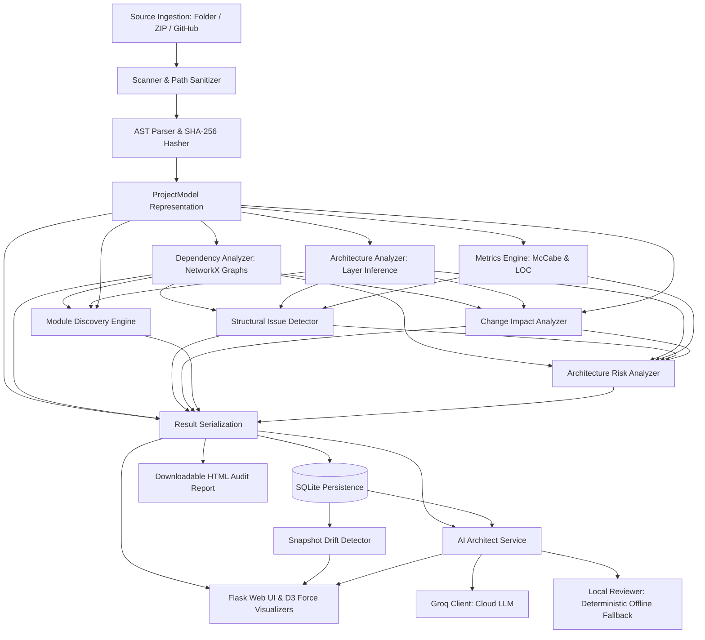

# ProjectDNA 🧬

**Python Codebase Intelligence, Architecture Mining, and Maintenance System**

ProjectDNA is an engineering-grade Python codebase intelligence system. Built with Python AST, NetworkX, and Flask, it extracts architectural layers, dependency graphs, and complexity metrics, while providing advanced codebase maintenance capabilities: **Change Impact Analysis**, **Temporal Architecture Drift Detection**, **Automatic Module Discovery & Refactoring Recommendations**, and **Explainable Architecture Risk Analysis**.

---

## 🌟 Advanced Intelligence Capabilities

### 1. ⚡ Change Impact Analysis (Phase 1)
Evaluates the downstream blast radius before modifying any Python module or file.
- **Direct & Transitive Dependents**: Distinguishes between immediate dependents (depth 1) and cascading indirect dependents (depth ≥ 2) via cycle-safe reverse traversal of the directed import graph ($G_{imports}$).
- **Dependency Paths**: Displays the exact chain of import dependencies leading from downstream components back to the modified module (`dependent → ... → target`).
- **Symbol Coupling**: Statically maps subclasses and function/method call sites in downstream files that directly depend on symbols in the modified module.
- **Regression Test Identification**: Automatically identifies downstream test suites that must be rerun to prevent regressions.
- **Explainable Impact Scoring**: Rates blast radius risk as `LOW`, `MEDIUM`, `HIGH`, or `CRITICAL` with an explicit human-readable architectural explanation.
- **Interactive D3 Subgraph**: Visualizes the local impact tree with color-coded nodes for target, direct dependents, transitive dependents, and test modules.

### 2. 🕒 Temporal Architecture Drift Detection (Phase 2)
Tracks architectural evolution and technical debt across multiple scans of the same project over time.
- **Deterministic Snapshot Diffs**: Guarantees zero false structural drift on unchanged projects.
- **Structural Event Tracking**: Reports added modules, removed modules, modified files (via SHA-256 content hashing), and conservative rename detection.
- **Dependency Shifts**: Highlights added and removed import edges between packages.
- **Circular Dependency Lifecycle**: Distinguishes newly introduced dependency cycles (`DEGRADATION`) from resolved dependency cycles (`REFACTORED`).
- **Metric Shifts**: Compares total lines of code, cyclomatic complexity spikes, and module coupling fluctuations.
- **Issue Lifecycle**: Tracks newly introduced architectural smells versus issues that were fixed.

### 3. 🧩 Automatic Module Discovery & Refactoring Recommendations (Phase 3)
Infers logical package boundaries and identifies organization anti-patterns without modifying source code.
- **Multi-Factor Cohesion Affinity**:
  - *Structural Coupling (40% weight)*: Direct and mutual import edges.
  - *Shared Dependencies (30% weight)*: Jaccard similarity of external and internal dependencies.
  - *Domain Vocabulary Similarity (30% weight)*: Jaccard similarity of identifiers (classes, methods, functions) after filtering generic programming stopwords (`utils`, `helper`, `manager`, `common`, `core`, etc.).
- **Cohesive Candidate Groups**: Discovers tightly coupled clusters of modules suitable for colocation into cohesive packages.
- **Misplaced Module Detection**: Flags files that are physically placed in a generic or distant folder (e.g. `utils/`) but logically and functionally belong to a different cohesive package.
- **Decomposition Candidates**: Identifies god modules exhibiting high line counts, multiple classes/functions, and low internal calling cohesion.
- **Cross-Package Coupling Warnings**: Detects excessive or bidirectional inter-package entanglements.
- **Small-Project Safeguard**: Projects with fewer than 4 modules report `INSUFFICIENT_EVIDENCE` rather than fabricating statistical noise.

### 4. 🛡️ Explainable Architecture Risk & Technical Debt Analysis (Phase 4)
Synthesizes static metrics into a prioritized, explainable architectural risk backlog.
- **Transparent Heuristic Scoring (0–100)**:
  - Default normalized weights: **Dependency Cycles (25%)**, **McCabe Complexity (25%)**, **Coupling & Hubs (20%)**, **Layer Violations (15%)**, and **Untested Core Modules (15%)**.
  - Fully configurable weights via API parameters.
  - Transparent factor contribution breakdown.
- **Prioritized Component Backlog**:
  - Components ranked by severity: `CRITICAL`, `HIGH`, `MEDIUM`, `LOW`.
  - Displays measured values with benchmark thresholds.
  - Explains architectural rationale (*"Why this issue matters"*).
  - Outlines concrete, actionable refactoring steps.
  - Directly links findings to file locations and blast radius tools.

### 5. 🤖 ProjectDNA AI Architect
Intelligent codebase review, refactoring advisor, change impact planner, and architecture Q&A powered by Groq API with a fully deterministic local static-analysis fallback engine.
- **Provider Selection & Resilient Fallback**:
  - `auto` (Default): Uses Groq when credentials and internet are available; automatically and gracefully falls back to deterministic local reviewer on any API timeout, rate-limit (429), authentication error, or network failure.
  - `groq`: Direct Groq API review.
  - `local`: 100% offline, zero-network deterministic review engine using verified AST metrics, cycle detection, coupling thresholds, and docstring checks.
- **Truth Boundary & Provenance Transparency**:
  - Distinguishes measured facts (`origin: static_rule`), AI hypotheses (`origin: ai_hypothesis`), and merged items (`origin: combined`).
  - Strict validation of source locations against real scanned project files. Nonexistent/hallucinated files are pruned.
- **Refactoring Advisor**:
  - Provides prioritized issue cards with severity (`CRITICAL`, `HIGH`, `MEDIUM`, `LOW`), concrete evidence, architectural explanation, recommendations, migration trade-offs, and validation test steps.
- **Change Impact Planner**:
  - Accepts developer proposals (e.g. *"Separate authentication logic from the user service"*), traces impacted files and dependency paths, generates a step-by-step implementation sequence, flags architectural risks, and outlines validation tests.
- **Ask ProjectDNA (Q&A)**:
  - Answers natural language questions regarding project architecture, complexity, cycles, and dependencies. Grounded strictly in static analyzer facts.
- **Security & Privacy Safeguards**:
  - Scanned repository contents are treated as untrusted data with anti-prompt-injection boundaries.
  - Automatic secret redaction for API keys, passwords, bearer tokens, and private keys.
  - Never transmits `.env` files or sensitive credential artifacts.

---

## 🏗️ System Architecture & Data Flow



---

## 📁 Repository Structure

```
ProjectDNA/
├── app.py                        # Flask application entry point, routing & APIs
├── database.py                   # SQLite persistence, schema versioning & snapshot queries
├── requirements.txt              # Core dependencies (Flask, NetworkX, Radon, GitPython, Groq, Pydantic)
├── .env.example                  # Example configuration template for optional Groq API key
├── .gitignore                    # Git exclusion rules (uploads, caches, temp files, env secrets)
├── README.md                     # Documentation, usage guide, and architecture specification
├── ai_architect/                 # AI Architect engine (Groq cloud LLM + local deterministic fallback)
│   ├── __init__.py               # Package export interface
│   ├── context_builder.py        # Token-bounded context synthesis with secret redaction
│   ├── groq_client.py            # Resilient Groq API client with auto-retry & error classification
│   ├── local_reviewer.py         # 100% offline, deterministic AST-grounded fallback reviewer
│   ├── prompts.py                # System instructions, strict JSON schemas & anti-injection barriers
│   ├── schemas.py                # Pydantic v2 validation models & truth boundary contracts
│   └── service.py                # Dual-mode facade orchestrating Groq API and local reviewer
├── analyzer/                     # Core intelligence engine
│   ├── __init__.py               # Analyzer package initializer
│   ├── ast_parser.py             # AST parsing, McCabe complexity, docstrings & SHA-256 hashing
│   ├── scanner.py                # Safe directory traversal & virtualenv exclusion
│   ├── project_model.py          # Data classes (ProjectModel, ModuleInfo, ClassInfo, etc.)
│   ├── dependency_analyzer.py    # NetworkX graph construction (imports, calls, inheritance)
│   ├── architecture_analyzer.py  # Layer inference heuristic & layer interaction graph
│   ├── metrics.py                # Line counting, McCabe complexity, and coupling summaries
│   ├── issue_detector.py         # Cycle detection, god modules, and layer violations
│   ├── impact_analyzer.py        # Phase 1: Downstream blast radius & path traversal
│   ├── drift_detector.py         # Phase 2: Deterministic snapshot diffing & drift tracking
│   ├── module_discovery.py       # Phase 3: Affinity clustering & misplaced module detection
│   ├── risk_analyzer.py          # Phase 4: Explainable risk scoring & technical debt backlog
│   └── pipeline.py               # Central orchestration pipeline returning unified representation
├── templates/                    # Jinja2 HTML templates
│   ├── base.html                 # Navigation layout & theme styling
│   ├── index.html                # Project ingestion (Folder/ZIP/GitHub) & past analyses
│   ├── dashboard.html            # Unified intelligence dashboard & hotspot cards
│   ├── ai_architect.html         # Interactive AI review, change impact planner & architecture Q&A
│   ├── impact.html               # Phase 1: Interactive Change Impact explorer
│   ├── drift.html                # Phase 2: Snapshot comparison and architecture drift view
│   ├── discovery.html            # Phase 3: Refactoring recommendations & clusters view
│   ├── risks.html                # Phase 4: Architecture risk backlog & score breakdown
│   ├── architecture.html         # Interactive D3.js dependency graph visualizer
│   ├── issues.html               # Filterable issue and quality smell explorer
│   ├── modules.html              # Module metric catalog
│   ├── module_detail.html        # Single-file deep dive (AST, calls, imports, impact link)
│   ├── report.html               # Standalone printable HTML audit report
│   └── components/               # Modular reusable UI components
│       └── project_subnav.html   # Sub-navigation bar with active tab highlighting
├── static/
│   └── css/
│       └── main.css              # Restrained, clean developer-tool stylesheet
├── tests/                        # Comprehensive automated test suite (70 tests)
│   ├── __init__.py               # Test package initializer
│   ├── test_ai_architect_service.py # Unit tests: service routing, fallbacks, model synthesis
│   ├── test_context_builder.py   # Unit tests: prompt context builder & secret redaction
│   ├── test_drift_detector.py    # Unit tests: identical diffs, additions, removals, renames
│   ├── test_fixtures.py          # Integration tests: multi-package realistic repository
│   ├── test_flask_routes.py      # Integration tests: Flask routes and JSON API responses
│   ├── test_groq_client.py       # Unit tests: Groq client error handling, retries, JSON parsing
│   ├── test_impact_analyzer.py   # Unit tests: chains, branches, cycles, symbols, paths
│   ├── test_local_reviewer.py    # Unit tests: offline deterministic review engine
│   ├── test_module_discovery.py  # Unit tests: clustering, misplaced modules, safeguards
│   ├── test_pipeline_e2e.py      # E2E tests: syntax error recovery & multi-version diffs
│   └── test_risk_analyzer.py     # Unit tests: risk scoring, weights sensitivity, backlog
└── uploads/                      # Temporary extraction directory (.gitkeep)
```

---

## 🚀 Getting Started

### Prerequisites
- Python 3.10+
- Git (optional, for GitHub repository cloning)

### Installation
1. **Clone the repository:**
   ```bash
   git clone https://github.com/anaconda2401/ProjectDNA.git
   cd ProjectDNA
   ```

2. **Create and activate a virtual environment:**
   ```powershell
   # Windows PowerShell
   python -m venv .venv
   .venv\Scripts\activate
   ```
   ```bash
   # Linux / macOS
   python3 -m venv .venv
   source .venv/bin/activate
   ```

3. **Install dependencies:**
   ```bash
   pip install -r requirements.txt
   ```

4. **(Optional) Configure Groq AI Architect:**
   ProjectDNA works 100% out-of-the-box using the deterministic local engine. To enable Groq AI-assisted reviews, copy `.env.example` to `.env` and provide your Groq API key:
   ```bash
   cp .env.example .env
   ```
   Edit `.env`:
   ```ini
   GROQ_API_KEY=gsk_your_key_here
   GROQ_MODEL=openai/gpt-oss-20b
   GROQ_TIMEOUT_SECONDS=30
   PROJECTDNA_AI_ENABLED=true
   ```

5. **Launch the web application:**
   ```bash
   python app.py
   ```

6. **Open in browser:**
   Navigate to [http://127.0.0.1:5000](http://127.0.0.1:5000)

---

## 🧪 Running Automated Tests

ProjectDNA includes 70 automated unit, integration, and end-to-end tests covering all intelligence capabilities, deterministic fallback handling, secret redaction, source validation, graph traversal directions, cycle termination, snapshot persistence, and error handling.

To run the complete test suite:

```bash
# In active virtual environment:
python -m unittest discover tests -v

# Or directly using virtual environment python:
.venv\Scripts\python.exe -m unittest discover tests -v    # Windows
.venv/bin/python -m unittest discover tests -v            # Linux / macOS
```

All 70 tests execute deterministically without external dependencies or live network calls (external APIs are cleanly mocked in unit tests).

---

## 📊 Application Endpoints & APIs

| Route | Method | Purpose |
|-------|--------|---------|
| `/` | `GET` | Home dashboard, past snapshot list, and multi-source upload |
| `/analyze` | `POST` | Ingests ZIP uploads and public GitHub URLs |
| `/analyze-folder` | `POST` | Ingests browser directory selections (`webkitdirectory`) |
| `/dashboard/<id>` | `GET` | Main project overview, metrics, and intelligence hotspot cards |
| `/ai-architect/<id>` | `GET` | **AI Architect**: Interactive codebase review, change planner, and Q&A |
| `/api/ai-review/<id>` | `GET/POST` | **AI Architect API**: Runs or retrieves AI review (`mode=auto|groq|local`) |
| `/api/ai-plan/<id>` | `POST` | **AI Architect API**: Evaluates architectural change impact & sequence |
| `/api/ai-ask/<id>` | `POST` | **AI Architect API**: Project-scoped Q&A grounded in verified AST facts |
| `/impact/<id>` | `GET` | **Phase 1**: Interactive Change Impact explorer |
| `/api/impact/<id>` | `GET` | **Phase 1 API**: Returns change blast radius JSON (`?module=<name>`) |
| `/drift/<id>` | `GET` | **Phase 2**: Dual snapshot comparison and drift report |
| `/api/drift` | `GET` | **Phase 2 API**: Compares two snapshots (`?base_id=<id>&target_id=<id>`) |
| `/discovery/<id>` | `GET` | **Phase 3**: Module clustering and refactoring recommendations |
| `/api/discovery/<id>` | `GET` | **Phase 3 API**: Returns refactoring recommendations JSON |
| `/risks/<id>` | `GET` | **Phase 4**: Architecture risk backlog and score breakdown |
| `/api/risks/<id>` | `GET` | **Phase 4 API**: Returns risk analysis with configurable weights (`?w_complexity=...`) |
| `/architecture/<id>` | `GET` | Interactive force-directed D3 dependency graph |
| `/modules/<id>` | `GET` | Complete module catalog with complexity and coupling |
| `/module/<id>/<path>` | `GET` | Single-file deep dive (AST symbols, call sites, and callers) |
| `/report/<id>` | `GET` | Generates self-contained standalone downloadable HTML audit report |
| `/api/graph/<id>` | `GET` | Returns full NetworkX node-link dependency graph |
| `/delete/<id>` | `POST` | Removes an analysis snapshot from SQLite storage |

---

## ⚠️ Safe Interpretations & Known Limitations

- **Truth Boundary (Facts vs Hypotheses)**: Measured static facts (dependency cycles, McCabe complexity, coupling counts, layer violations) are source of truth. AI findings are clearly labeled as hypotheses and validated against actual code artifacts.
- **Static vs Runtime Analysis**: Change impact analysis and dependency graphs are derived from Python AST and static imports. Dynamic imports (e.g. `importlib.import_module`, runtime `__import__`, or dynamic plugin registries) cannot be fully detected without executing untrusted code.
- **Blast Radius vs Failure Guarantee**: A module identified as a downstream dependent is *potentially affected* by interface shifts; static analysis cannot guarantee runtime failure.
- **Non-Destructive Recommendations**: The refactoring engine only suggests organizational improvements; it never alters user source files, rewrites import paths, or executes code.
- **Small Codebase Safeguards**: Clustering algorithms require at least 4 modules to provide meaningful recommendations. For smaller repositories, ProjectDNA explicitly reports insufficient evidence rather than hallucinating groupings.
- **Heuristic Labeling**: Architecture risk scores are heuristic approximations designed for backlog prioritization, not scientifically absolute indices.
