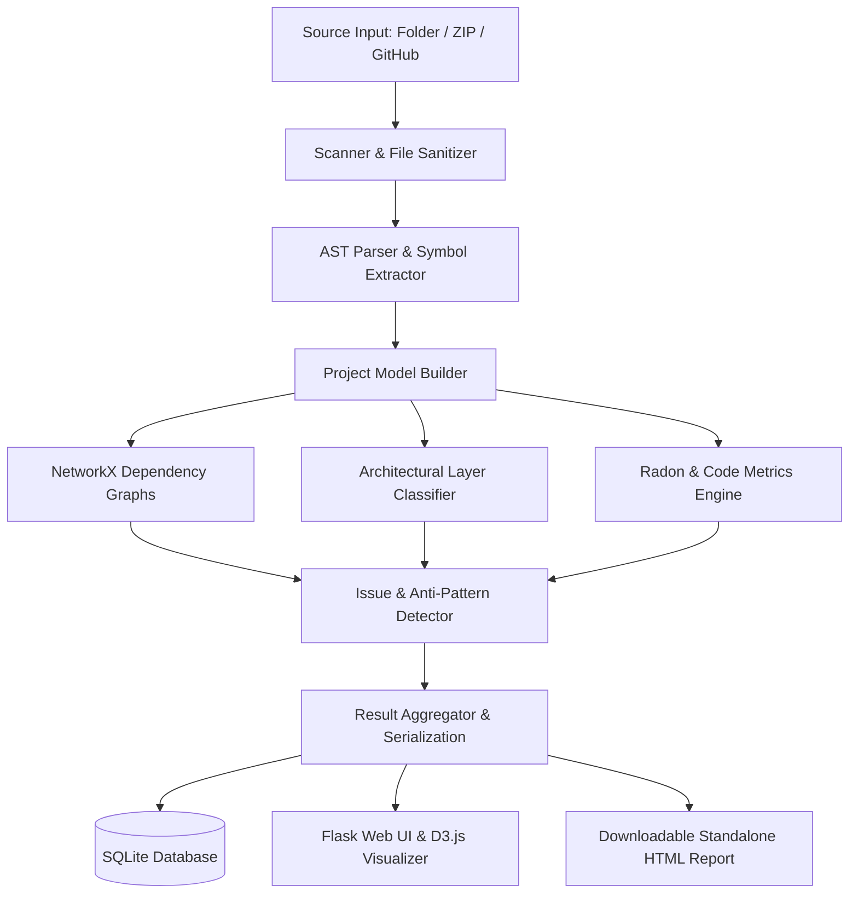

# ProjectDNA 🧬

**Automated Software Architecture Mining and Codebase Intelligence for Python Projects**

ProjectDNA is a web application built with Flask, AST parsing, and NetworkX that extracts architectural layers, dependency graphs, code metrics, and structural code smells from any Python codebase. Simply upload a ZIP archive, select a local folder, or provide a public GitHub URL to mine the software architecture and explore it interactively.

---

## 🌟 Key Features

- **Multi-Source Code Ingestion**
  - **Folder Upload**: Select a directory directly in the browser via `webkitdirectory` with smart client- and server-side filtering (ignores virtual environments, bytecode, and non-Python clutter).
  - **ZIP Upload**: Drag & drop or upload ZIP archives up to 50 MB with path sanitization to prevent Zip Slip vulnerabilities.
  - **GitHub URL**: Automatically clone shallow Git repositories (`depth=1`) for instantaneous remote codebase analysis.

- **AST-Powered Code Extraction**
  - Syntactic parsing using Python's native `ast` module.
  - Recursively discovers functions, methods, classes, base inheritance, and decorators.
  - Tracks symbol calls (`caller -> callee`) and import dependencies (`import`, `from ... import`, aliasing, relative imports).

- **Architectural Layer Inference**
  - Automatically identifies architectural tiers based on package structure and naming conventions:
    - **Config**: Settings, environment, conf
    - **Utility**: Helpers, common utilities, shared libraries
    - **Data**: Models, database schemas, ORMs, entities, repositories
    - **Service**: Business logic, domain rules, use-cases
    - **Presentation**: Web routes, APIs, views, controllers, blueprints
    - **CLI**: Commands, terminal runners, scripts
    - **Test**: Test suites, pytest fixtures, mocks
  - Generates aggregated layer-to-layer dependency interaction graphs.

- **Interactive Dependency Visualization**
  - Force-directed interactive D3.js graph visualizer with zoom, pan, and node drag.
  - Layer-based node filtering and module search.
  - Side-panel inspector displaying fan-in, fan-out, complexity, and line counts for any selected module.

- **Automated Issue & Anti-Pattern Detection**
  - **Circular Imports**: Detects cyclical dependency chains (`A → B → A`) using NetworkX cycle detection algorithms.
  - **Layer Violations**: Flags architecture violations where lower abstraction layers depend directly on higher presentation or service layers.
  - **High Complexity**: Identifies functions and methods with high (>10) or critical (>20) McCabe cyclomatic complexity.
  - **Excessive Coupling**: Highlights architectural bottlenecks (fan-in ≥ 6) and fragile modules (fan-out ≥ 8).
  - **God Modules / Classes**: Warns about oversized files (>400 LOC), modules with excessive functions (>20), or too many classes (>8).
  - **Dead / Isolated Internal Modules**: Flags modules that are never referenced by any other project module.
  - **Syntax & Parse Errors**: Isolates unparseable or corrupted Python files without failing the whole pipeline.

- **Code Metrics & Catalog**
  - Computes total lines of code, blank lines, comment lines, and physical code lines.
  - McCabe Cyclomatic Complexity per function/method, module average, and project total.
  - Third-party vs standard library dependency classification.

- **Exportable Reports & Persistence**
  - **Standalone Audit Report**: Generate and download self-contained HTML audit reports for offline review or sharing with stakeholders.
  - **SQLite Persistence**: Stores analysis snapshots locally to instantly revisit past analyses without re-running.

---

## 🏗️ Architecture & Pipeline Flow



---

## 📁 Repository Structure

```
ProjectDNA/
├── app.py                        # Flask server, routing, upload handlers & API
├── database.py                   # SQLite persistence layer for analysis runs
├── requirements.txt              # Core Python dependencies
├── analyzer/                     # Core analysis engine
│   ├── scanner.py                # Safe filesystem traversal & filtering
│   ├── ast_parser.py             # Python AST visitor (classes, functions, calls, imports)
│   ├── project_model.py          # Data models (ProjectModel, ModuleInfo, etc.)
│   ├── dependency_analyzer.py    # NetworkX graph builder (imports, calls, inheritance)
│   ├── architecture_analyzer.py  # Layer heuristic inference & layer graphs
│   ├── metrics.py                # McCabe complexity, LOC, fan-in / fan-out
│   ├── issue_detector.py         # Architectural violations, cycles, code smells
│   └── pipeline.py               # Orchestration pipeline
├── templates/                    # Jinja2 HTML templates
│   ├── base.html                 # Base page layout with navigation
│   ├── index.html                # Project upload & past analysis catalog
│   ├── dashboard.html            # Metrics overview, charts & library breakdown
│   ├── architecture.html         # Interactive D3.js dependency graph visualizer
│   ├── issues.html               # Filterable issue and quality smell explorer
│   ├── modules.html              # Module metric catalog
│   ├── module_detail.html        # Single-file deep dive (AST, calls, imports)
│   └── report.html               # Self-contained standalone printable HTML audit report
├── static/
│   └── css/
│       └── main.css              # Dark glassmorphic design system
└── uploads/
    └── .gitkeep                  # Temporary staging directory for uploads
```

---

## 🚀 Getting Started

### Prerequisites

- Python 3.10+
- Git (required for cloning GitHub repositories)

### Installation

1. **Clone the repository:**
   ```bash
   git clone https://github.com/anaconda2401/ProjectDNA.git
   cd ProjectDNA
   ```

2. **Create and activate a virtual environment:**
   ```bash
   # Windows
   python -m venv .venv
   .venv\Scripts\activate

   # Linux / macOS
   python3 -m venv .venv
   source .venv/bin/activate
   ```

3. **Install dependencies:**
   ```bash
   pip install -r requirements.txt
   ```

4. **Launch the application:**
   ```bash
   python app.py
   ```

5. **Open in browser:**
   Navigate to [http://127.0.0.1:5000](http://127.0.0.1:5000)

---

## ⚙️ Operational Limits & Defaults

| Parameter | Limit | Description |
|-----------|-------|-------------|
| **Max ZIP Archive Size** | 50 MB | Maximum allowed `.zip` file upload |
| **Max Folder Upload Size** | 80 MB | Total combined size for direct folder uploads |
| **Max Uploaded Files** | 600 files | Maximum file count in a single folder upload |
| **Max File Size** | 1 MB | Per single `.py` file analyzed |
| **Max Project Files** | 500 files | Analyzed by the AST parser |
| **Ignored Directories** | `.venv`, `venv`, `node_modules`, `.git`, `__pycache__`, `build`, `dist`, `.tox` | Automatically skipped during scanning |

---

## 📊 Application Endpoints

| Route | Method | Description |
|-------|--------|-------------|
| `/` | `GET` | Home dashboard, past analyses list, and upload forms |
| `/analyze` | `POST` | Processes ZIP upload and GitHub URL repository clones |
| `/analyze-folder` | `POST` | Asynchronous endpoint for direct browser folder uploads |
| `/dashboard/<id>` | `GET` | Overview metrics, layer distribution, top hotspots, external libraries |
| `/architecture/<id>` | `GET` | Interactive force-directed D3.js dependency graph |
| `/issues/<id>` | `GET` | Code quality smells, circular dependencies, and layer violations |
| `/modules/<id>` | `GET` | Full module catalog with complexity and coupling scores |
| `/module/<id>/<path>` | `GET` | Module deep-dive with AST symbols and intra-project relationships |
| `/report/<id>` | `GET` | Downloads self-contained standalone HTML audit report |
| `/api/graph/<id>` | `GET` | JSON representation of the module dependency graph |
| `/delete/<id>` | `POST` | Removes an analysis from local SQLite storage |

---

## 🛠️ Tech Stack

- **Backend**: Python 3, [Flask](https://flask.palletsprojects.com/)
- **Analysis & Math**: Python AST, [NetworkX](https://networkx.org/), [Radon](https://radon.readthedocs.io/), [GitPython](https://gitpython.readthedocs.io/)
- **Frontend**: Vanilla JavaScript, Jinja2, [D3.js](https://d3js.org/)
- **Styling**: Vanilla CSS (Modern dark glassmorphic design system)
- **Database**: SQLite3
